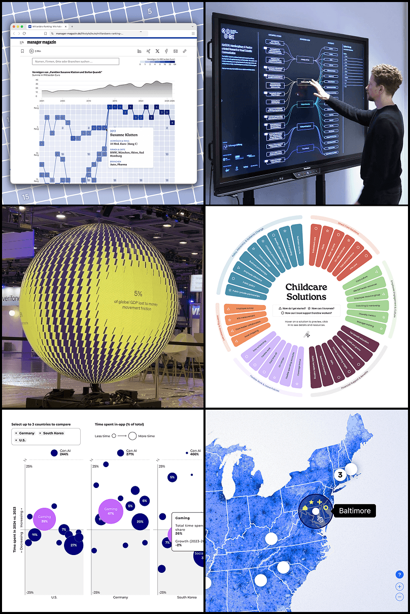

# Hi, I'm Kristin - a freelance data visualization developer 👋

Your data is **meant to be communicated**. Your technical setup doesn't have to get in the way. I turn an organization's data or research into a finished, interactive experience that gets its audience reading, clicking, acting.

I **own the full process**, from idea to launch, so it doesn't fall on you to pull the pieces together. Whatever your existing site or tech stack, I build the visualization to work with what's already there, from CMS-constrained embeds to full custom stacks.

What I build: standalone interactive visualizations, interactive web-based reports, data storytelling sites, data platforms, and data art pieces.

I work remotely with agencies and clients all over the world while living in Berlin, Germany.

Find out more and get in touch: 
[Website](https://www.kristin-baumann.com/) | [LinkedIn](https://www.linkedin.com/in/kristinbaumann/) | [Email](mailto:hello@kristin-baumann.com)

