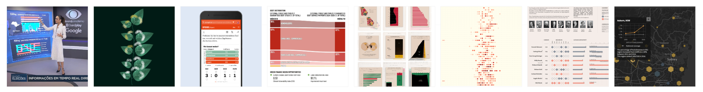

Hi  👋

I am a **freelance Data Visualization Developer** building custom, interactive data visualizations with code that turn your data into engaging experiences. 
Mostly using **D3.js**, **React**, **Svelte**, and more. 

I work remotely with agencies and clients all over the world while living in Berlin, Germany.

Find out more and get in touch: 
[Website](https://www.kristin-baumann.com/) | [LinkedIn](https://www.linkedin.com/in/kristinbaumann/) | [Email](mailto:hello@kristin-baumann.com)

